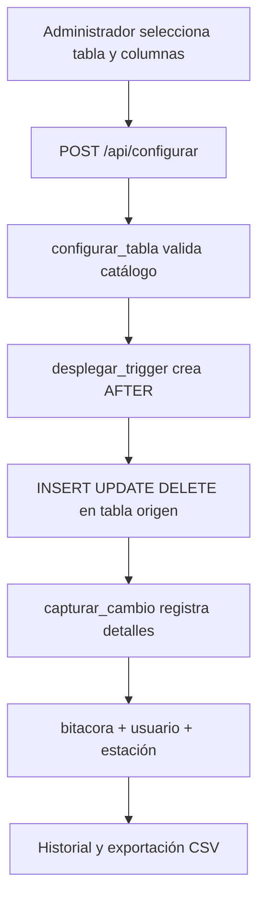
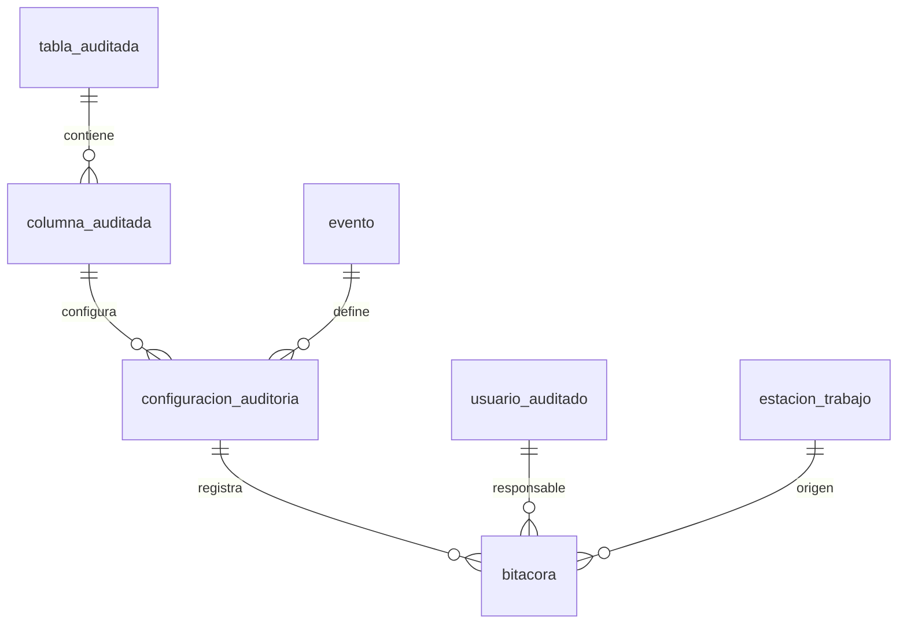

# Arquitectura técnica y diccionario de datos

## Objetivo

Configurar auditorías por tabla y columna en PostgreSQL 18 y conservar eventos INSERT, UPDATE y DELETE mediante triggers AFTER generados automáticamente.

## Componentes

- **Interfaz:** HTML, CSS, JavaScript (sin npm ni compilación).
- **Servidor:** Python / Flask con API local y conexión `psycopg`.
- **Persistencia:** PostgreSQL 18 (esquemas `auditoria`, `demo`, `gestion`) y SQLite local para credenciales de la interfaz.
- **Seguridad:** roles PostgreSQL `auditoria_admin` y `auditoria_lector` y cuenta técnica local de la app. Roles web `admin` y `usuario` en `auth_local.py` con contraseña scrypt y sesión firmada/CSRF. Triggers y funciones SECURITY DEFINER mantienen escritura de bitácora fuera del acceso directo.

## Flujo

## Relaciones ER

## Diccionario

| Entidad | Clave | Campos principales | Propósito |
|---|---|---|---|
| `tabla_auditada` | `id_tabla` | `esquema`, `nombre_tabla`, `activa`, `fecha_creacion` | Fuente configurada |
| `columna_auditada` | `id_columna` | `id_tabla`, `nombre_columna` | Columnas vigiladas |
| `evento` | `id_evento` | `nombre` | Catálogo INSERT, UPDATE, DELETE |
| `configuracion_auditoria` | `id_config` | `id_columna`, `id_evento`, `activo` | Regla por columna y operación |
| `usuario_auditado` | `id_usuario` | `nombre_usuario` | Identidad PostgreSQL |
| `estacion_trabajo` | `id_estacion` | `ip_origen`, `nombre_host` | Equipo de origen |
| `bitacora` | `id_bitacora` | `id_config`, `id_usuario`, `id_estacion`, `fecha_hora`, `registro_pk`, `valor_anterior`, `valor_nuevo`, `fila_anterior`, `fila_nueva`, `aplicacion` | Historial inalterable para roles de aplicación |

## Restricciones de diseño

- `configurar_tabla` valida la existencia real del esquema, tabla y columnas contra `pg_catalog`.
- Se exige una clave primaria para correlacionar registros. La clave se conserva en JSONB y admite claves compuestas.
- Cada tabla supervisada recibe solo un trigger `AFTER` generado dinámicamente; su función es compartida.
- Las operaciones `UPDATE` se registran únicamente si el valor de la columna cambió.
- La bitácora no tiene FK directa a la fila origen para preservar historial después de `DELETE`, pero sí mantiene FK contra configuración, usuario y estación.
- La aplicación restringe el servidor HTTP a `127.0.0.1`, sin exposición en red.

## Limitaciones

- El administrador de la base o un superusuario puede modificar la bitácora. Los permisos impiden escritura desde cuentas normales, no frente a administradores de PostgreSQL.
- No se auditan cambios realizados por `TRUNCATE` ni modificaciones DDL.
- Si se elimina una tabla vigilada, hay que revisar su configuración y volver a desplegar después de recrearla.
- Para operaciones realizadas desde la web, la aplicación envía el usuario autenticado en la variable transaccional `autoaudit.actor` y el trigger la registra. Para operaciones externas se utiliza el usuario PostgreSQL. El identificador puede ser alterado por cualquier cliente que tenga acceso directo a la cuenta técnica, por lo que esta debe mantenerse privada.
- Se incluye autenticación web local con sesiones y CSRF; no existe TLS/HTTPS ni control de acceso de red para publicar en Internet. Es una aplicación para prácticas en localhost.
